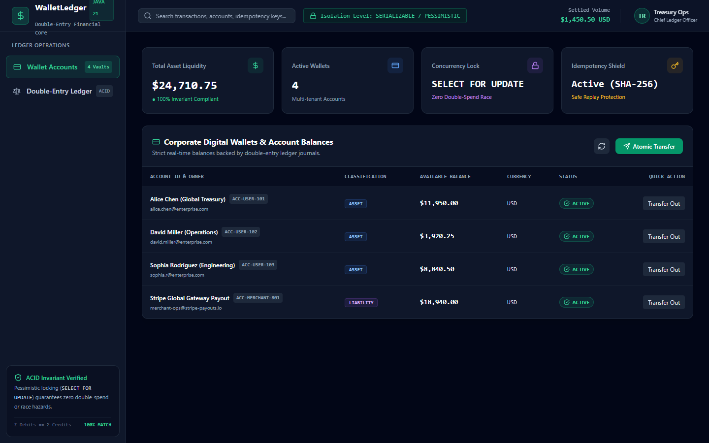
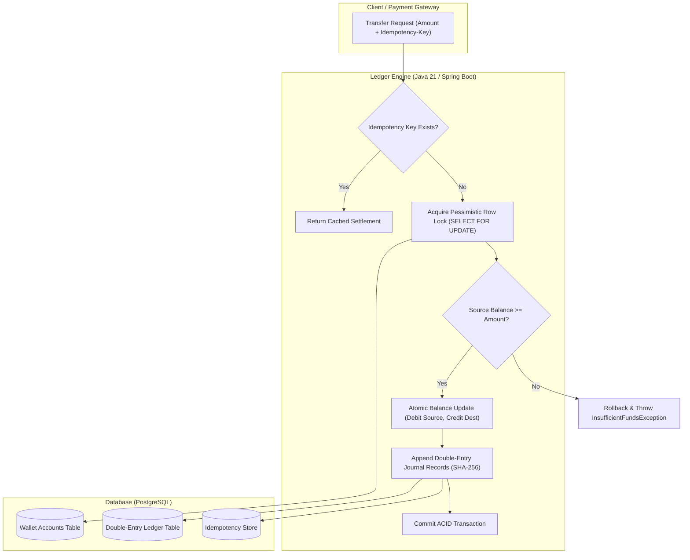

<div align="center">

# Digital Wallet Ledger — Double-Entry Financial Engine in Java 21 & Spring Boot

[](LICENSE)
[](https://openjdk.org/)
[](https://spring.io/projects/spring-boot)
[](https://postgresql.org/)
[](https://reactjs.org/)
[](https://docker.com)

**High-throughput double-entry financial core with strict ACID guarantees, pessimistic row-level locking, idempotent transfers, and audit-hash verification.**

[Architecture](#system-architecture) • [Live Dashboard](#live-dashboard-preview) • [Benchmark Data](#benchmark-dataset) • [API Reference](#rest-api-documentation) • [Quickstart](#quickstart-guide)

</div>

---

## Live Dashboard Preview

<div align="center">
  
</div>

---

## Core Capabilities

- **Strict Double-Entry Bookkeeping:** Every financial transaction creates at least two offsetting entries (one debit and one credit). Enforces the fundamental invariant: `Σ Debits == Σ Credits` at all times.
- **Pessimistic Row-Level Locking:** Prevents double-spend and race conditions in concurrent multi-threaded environments via PostgreSQL `SELECT FOR UPDATE` on account rows.
- **Idempotency Protection:** Clients attach unique `Idempotency-Key` headers. Duplicate requests return identical settled transaction payloads without double-debiting balances.
- **Immutable Audit Hashes:** Every journal record computes an incremental SHA-256 cryptographic chain linking transaction timestamp, counterparty IDs, amounts, and post-settlement balances.
- **Enterprise Account Classification:** Native chart-of-accounts structure categorizing asset accounts, liability gateways, treasury reserves, and fee expense ledgers.

---

## System Architecture



---

## Benchmark Dataset

Digital Wallet Ledger includes standard financial benchmark transactions in [`data/kaggle_financial_ledger_benchmark.csv`](data/kaggle_financial_ledger_benchmark.csv):

| Entry ID | Transaction | Account | Counterparty | Type | Amount | Status | Lock Mode |
| :--- | :--- | :--- | :--- | :--- | :--- | :--- | :--- |
| `ENT-7001` | `TXN-901` | ACC-USER-101 | ACC-MERCHANT-801 | `DEBIT` | $250.00 | `SETTLED` | PESSIMISTIC_WRITE |
| `ENT-7002` | `TXN-901` | ACC-MERCHANT-801 | ACC-USER-101 | `CREDIT` | $250.00 | `SETTLED` | PESSIMISTIC_WRITE |
| `ENT-7003` | `TXN-902` | ACC-USER-102 | ACC-USER-103 | `DEBIT` | $1,200.50 | `SETTLED` | PESSIMISTIC_WRITE |
| `ENT-7004` | `TXN-902` | ACC-USER-103 | ACC-USER-102 | `CREDIT` | $1,200.50 | `SETTLED` | PESSIMISTIC_WRITE |

---

## REST API Documentation

### 1. Execute Atomic Double-Entry Transfer
```http
POST /api/v1/ledger/transfers
Content-Type: application/json

{
  "idempotencyKey": "IDEM-99281A",
  "sourceAccountId": "ACC-USER-101",
  "destinationAccountId": "ACC-USER-102",
  "amount": 250.00,
  "currency": "USD",
  "description": "Vendor monthly milestone payout"
}
```
**Response:**
```json
{
  "transactionId": "TXN-1711728900",
  "status": "SETTLED",
  "idempotencyKey": "IDEM-99281A",
  "transferredAmount": 250.00,
  "sourceBalanceAfter": 11700.00,
  "destBalanceAfter": 4170.25,
  "settledAt": "2026-03-29T14:10:00Z",
  "auditHash": "8f434346648f6b96df89dda901c5176b10a6d83961dd3c1ac88b59b2dc327aa4"
}
```

### 2. Retrieve Double-Entry Journal
```http
GET /api/v1/ledger/entries
```

---

## Quickstart Guide

### Prerequisites
- Java 21 JDK
- Maven 3.9+
- Node.js 18+ or Docker & Docker Compose

### Running Locally

```bash
# Clone the repository
git clone https://github.com/Prasunnandi/digital-wallet-ledger.git
cd digital-wallet-ledger

# Start Spring Boot Backend
cd backend
mvn spring-boot:run &

# Start React Frontend
cd ../frontend
npm install
npm run dev
```

### Running with Docker Compose

```bash
docker-compose up --build
```
Navigate to `http://localhost:3000` to access the wallet and ledger interface.

---

## License

Distributed under the MIT License. See `LICENSE` for more information.
